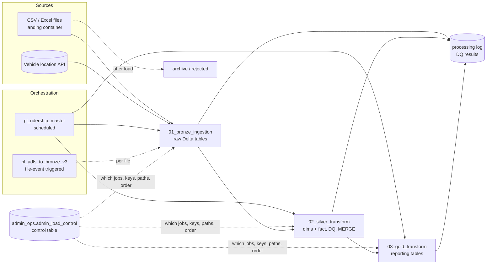

# Transit Ridership Lakehouse — Microsoft Fabric

A metadata-driven **Bronze → Silver → Gold** lakehouse in Microsoft Fabric for transit ridership data. Schedule, route, stop, trip and ridership files plus a vehicle-location API are ingested, cleaned into a dimensional model with data-quality checks, and published as Gold reporting tables. **Every job is driven by a control table**: adding a source or a transformation is a new row, not new pipeline code.

> Built during my internship. This is a cleaned copy: client and vendor names, storage accounts, workspace / lakehouse / notebook IDs, endpoints, secrets and all data outputs have been removed or replaced with placeholders like `<storage_account>`.

## Architecture

## Components

| Path | What it is |
|---|---|
| `pipelines/pl_ridership_master.json` | Master pipeline: Bronze → Silver → Gold notebooks in sequence, retry on each, per-stage success/failure webhook to a Logic App |
| `pipelines/pl_adls_to_bronze_v3.json` | Event-driven pipeline: a file landing in ADLS is matched to the control table, validated, ingested, archived or routed to a reject folder, with email alerts |
| `notebooks/01_bronze_ingestion.ipynb` | Reads active Bronze jobs from the control table; loads CSV / Excel files with explicit schemas and the vehicle API (key from Azure Key Vault); incremental `MERGE` on stable SHA-256 row IDs; audit columns; write retries; archive-and-delete of processed files; run logging |
| `notebooks/02_silver_transform.ipynb` | Builds dimensions (schedule, stop, route, trip, vehicle, block, direction, media type, date, ...) and `fact_ridership`; keeps the latest record per key, Type-1 `MERGE`, 21 data-quality checks logged to `admin_dq_results` |
| `notebooks/03_gold_transform.ipynb` | Metadata-driven Gold: scheduled ridership, overall ridership and ridership detail tables, with input validation, DQ checks and logging |
| `sql/admin_framework.sql` | The framework: control, logging, processing-log and DQ-results tables, plus the seed rows that define every job |
| `sql/legacy_load_control.sql` | Earlier control table used by the event-driven pipeline |

## Design decisions

| Decision | Why |
|---|---|
| **Control table drives every layer** (`TRANSFER_TYPE` = `FILE_TO_BRZ`, `BRZ_TO_SIL`, `SIL_TO_GOLD`) | New sources and targets are configuration. `EXECUTION_ORDER` and `JOB_DEPENDENCIES` sequence the work; `RUN_ACTIVE_FLAG` turns jobs on and off. |
| **One notebook per layer, parameterized** (`p_source_key`, `p_target_table`) | Blank = run every active job for that layer; a key = run one job. Same code for full runs and targeted reruns. |
| **Stable SHA-256 row IDs + incremental MERGE in Bronze** | Re-ingesting a file updates rows instead of duplicating them. |
| **DQ results stored as data** (`admin_dq_results`: rule, severity, failed count, sample) | Data quality is queryable and trendable, not buried in logs. |
| **Processing log for every job** (start/end, duration, rows, status, error) | One table answers "what ran, how long, what failed". |
| **Secrets from Key Vault, not parameters** | The API key never appears in pipeline definitions or run history. |
| **Archive and reject containers** | Landing holds only unprocessed files; failed files are kept for triage, by failure type. |

## How to deploy

1. Create a Fabric Lakehouse and run `sql/admin_framework.sql` (and `sql/legacy_load_control.sql` for the event-driven pipeline).
2. Create an ADLS Gen2 account with `landing`, `archive` and `rejected` containers; set `STORAGE_ACCOUNT` in `01_bronze_ingestion`.
3. Store the vehicle API key in Azure Key Vault as `vehicle-api-key`, set `KEY_VAULT_URL` / the API host, and give the API job `source_name = 'vehicle'` in the control table (that's how Bronze recognizes it).
4. Import the notebooks and the pipeline JSONs; replace `<WORKSPACE_ID>`, `<NB_*_ID>`, `<LOGIC_APP_TRIGGER_PATH>`, `<ALERT_EMAIL>` and bind the connections.

## Known issues & next improvements

Found while reviewing the code for this repo:

**Event-driven pipeline (`pl_adls_to_bronze_v3`)**
- Silver / Gold notebook calls pass parameter names with a **leading space** (`" p_file_name"`), so those values never reach the notebooks.
- Path normalization strips `landing/` before `/landing/`, so `/landing/x` becomes `/x` and never matches the control table.
- Validation, archive and cleanup activities are **disabled** and marked "succeeded" when skipped, so the validation-failure branch cannot fire.
- Archive uses a CSV copy with type conversion; a binary copy would preserve files byte for byte.

**Master pipeline (`pl_ridership_master`)**
- Failure / success notifications are disabled; error messages are hard-coded instead of `@activity(...).error.message`.
- The JSON body is built by string concatenation (breaks on quotes) and the signed webhook URL is logged because `secureInput` is off.
- `p_target_table` is passed empty and `p_workspace_name` is unused.

**Notebooks**
- `02_silver_transform` builds log IDs with Python's `hash()`, which is randomized per process, so IDs aren't reproducible; `03_gold_transform` already uses a stable SHA-256 (`stable_bigint`) and Silver should too.
- The event-driven pipeline reads the older `admin_sch.load_control` while the notebooks use `admin_ops.admin_load_control`; consolidating on one control table is the next step.

## Tech

Microsoft Fabric (Data Pipelines, Lakehouse, Notebooks) · PySpark · Delta Lake (MERGE) · Spark SQL · ADLS Gen2 · Azure Key Vault · Azure Logic Apps · Office 365 alerts
